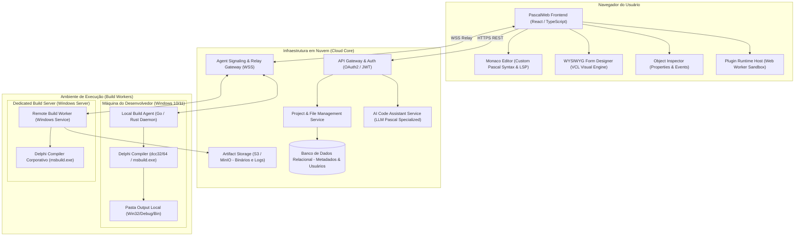
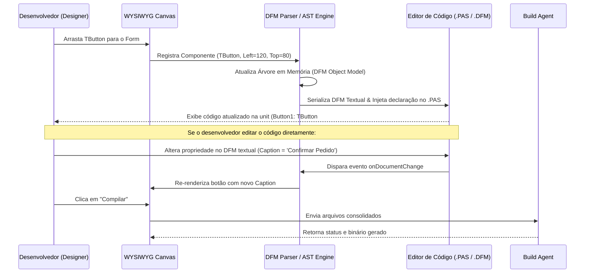
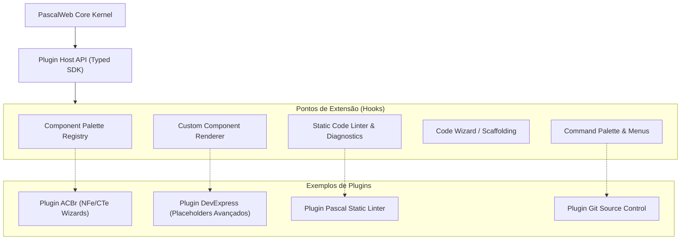

# 02 - Arquitetura de Software e Engenharia de Sistemas

> **Projeto:** PascalWeb IDE  
> **Área:** Arquitetura de Solução, Infraestrutura e Engenharia de Compiladores  
> **Status:** Documento de Especificação Técnica - Baseline 1.0  

---

## 1. Visão Geral da Arquitetura (C4 Model)

A **PascalWeb IDE** adota uma arquitetura distribuída e desacoplada, separando a camada de apresentação e edição (Client-side Web SPA), a camada de orquestração e gerenciamento de projetos (Cloud API Server) e os executores de compilação especializados em ambiente Windows (**Build Agents**).

### 1.1 Diagrama de Contexto de Sistema (C4 Level 1)

```mermaid
graph TD
    User["Desenvolvedor Delphi (Navegador)"]
    WebIDE["PascalWeb IDE (Web SPA)"]
    CloudServer["PascalWeb Cloud API & Orchestrator"]
    LocalAgent["Build Agent Local (Desktop Bridge Windows)"]
    ServerAgent["Build Agent Servidor (Dedicated Worker Windows)"]
    RadStudio["Embarcadero RAD Studio / MSBuild (Local)"]
    RadServer["Embarcadero Compiler / MSBuild (Servidor)"]

    User -->|Acessa via HTTPS/WSS| WebIDE
    WebIDE -->|REST / WebSocket (Edição, DFM, Projetos)| CloudServer
    WebIDE <-->|WebSocket Seguro (Compilação Direta P2P/Bridge)| LocalAgent
    CloudServer <-->|Fila de Jobs / gRPC| ServerAgent
    LocalAgent -->|Invoca CLI: dcc32, dcc64, msbuild| RadStudio
    ServerAgent -->|Invoca CLI: dcc32, dcc64, msbuild| RadServer
    LocalAgent -->|Devolve Binários EXE/DLL/BPL e Logs| WebIDE
    ServerAgent -->|Devolve Binários e Logs| CloudServer
```

---

### 1.2 Diagrama de Contêineres da Solução (C4 Level 2)



---

## 2. Topologia de Comunicação e Protocolo do Build Agent

### 2.1 Modelo Híbrido: Local Agent vs Server Agent

| Dimensão | Agente Local (Desktop Bridge) | Agente de Servidor (Dedicated Remote Worker) |
| :--- | :--- | :--- |
| **Local de Execução** | Estação Windows do próprio desenvolvedor | Servidor dedicado on-premise ou cloud corporativa |
| **Licenciamento Delphi** | Utiliza a licença já existente do desenvolvedor | Exige licença corporativa/Build Node do Delphi |
| **Componentes de Terceiros** | Acesso nativo a todas as BPLs e libs instaladas (DevExpress, ACBr, Fortes) | Requer provisionamento prévio de todas as dependências no servidor |
| **Segurança e Privacidade** | O código não precisa sair da máquina local para compilar | O código é enviado para o servidor de build temporariamente |
| **Geração de Artefatos** | O executável (`.exe`, `.dll`) é gerado diretamente na pasta local do desenvolvedor | O artefato é compactado e enviado para download na Web IDE |
| **Caso de Uso Ideal** | Desenvolvimento diário, depuração rápida e times com libs proprietárias | CI/CD, builds automatizados de homologação e padronização |

---

### 2.2 Protocolo de Comunicação (JSON-RPC 2.0 sobre WebSocket Seguro)

A comunicação entre a Web IDE e o Build Agent opera sobre WebSocket (`wss://`) utilizando JSON-RPC 2.0 com streaming de mensagens:

#### A. Handshake e Pareamento Seguro (`agent.handshake`)
```json
{
  "jsonrpc": "2.0",
  "id": "1",
  "method": "agent.handshake",
  "params": {
    "pairingToken": "sec_tok_98a7df6b8e124c90",
    "clientVersion": "1.0.0",
    "environment": {
      "os": "Windows 11 Enterprise 64-bit",
      "delphiVersions": [
        {
          "version": "12.0 Athens",
          "bdsPath": "C:\\Program Files (x86)\\Embarcadero\\Studio\\23.0",
          "compilerAvailable": ["dcc32", "dcc64", "msbuild"]
        }
      ]
    }
  }
}
```

#### B. Solicitação de Compilação (`build.execute`)
```json
{
  "jsonrpc": "2.0",
  "id": "2",
  "method": "build.execute",
  "params": {
    "buildId": "bld_49382170",
    "projectFilePath": "C:\\Projetos\\ERP\\GestaoVendas.dproj",
    "target": "Build",
    "platform": "Win32",
    "config": "Debug",
    "modifiedFiles": [
      {
        "relativePath": "src\\views\\ufrmprincipal.pas",
        "contentSha256": "8a3e...b1",
        "content": "...(conteúdo atualizado)..."
      },
      {
        "relativePath": "src\\views\\ufrmprincipal.dfm",
        "contentSha256": "4c21...f9",
        "content": "...(conteúdo atualizado do DFM)..."
      }
    ]
  }
}
```

#### C. Streaming de Diagnóstico e Mensagens de Log (`build.streamLog`)
O agente faz streaming em tempo real das mensagens geradas pelo compilador, realizando o parse regex estruturado:
```json
{
  "jsonrpc": "2.0",
  "method": "build.streamLog",
  "params": {
    "buildId": "bld_49382170",
    "type": "diagnostic",
    "diagnostic": {
      "file": "src\\views\\ufrmprincipal.pas",
      "line": 42,
      "column": 15,
      "severity": "Error",
      "code": "E2003",
      "message": "Undeclared identifier: 'TBlocoOperacao'"
    }
  }
}
```

#### D. Conclusão da Compilação e Artefatos (`build.complete`)
```json
{
  "jsonrpc": "2.0",
  "id": "2",
  "result": {
    "buildId": "bld_49382170",
    "status": "Success",
    "durationMs": 3410,
    "errorCount": 0,
    "warningCount": 2,
    "hintCount": 5,
    "artifacts": [
      {
        "fileName": "GestaoVendas.exe",
        "fileSizeBytes": 14589952,
        "sha256": "772f8a...c0",
        "localPath": "C:\\Projetos\\ERP\\bin\\Win32\\Debug\\GestaoVendas.exe",
        "downloadUrl": "https://api.pascalweb.dev/artifacts/bld_49382170/GestaoVendas.exe"
      }
    ]
  }
}
```

---

## 3. Engenharia do Form Designer WYSIWYG

O Form Designer é um dos componentes mais críticos da arquitetura. Ele permite ao desenvolvedor manipular visualmente a interface VCL e sincronizar bidirecionalmente com os arquivos `.dfm` e `.pas`.

### 3.1 Ciclo de Vida da Sincronização Bidirecional



---

### 3.2 O Parser DFM (Delphi Form File)

O Delphi armazena formulários em formato texto (`object Form1: TForm1 ... end`) ou binário legado (`TPFM`). O subsistema de parsing da PascalWeb IDE implementa:
1. **Conversor Universal Binário -> Texto:** Utilização de rotina de descompactação baseada na especificação do stream `TPFM` para converter qualquer formulário binário legado em texto limpo.
2. **Gramática e AST de DFM:**
   * **Objetos e Herança:** `object`, `inherited`, `inline`.
   * **Propriedades Atômicas:** Strings, Inteiros, Booleans, Enums (ex: `Align = alClient`).
   * **Coleções e Listas:** Propriedades compostas (ex: `Items.Strings = ('Item 1', 'Item 2')`).
   * **Objetos Aninhados:** Componentes filhos pertencentes a um pai (ex: `TPanel` contendo `TButton`).
3. **Sincronização com o Código Pascal (`.pas`):**
   * Ao adicionar um componente `btnSalvar: TButton` visualmente, o motor insere automaticamente na seção `published` da classe do formulário:
   ```pascal
   type
     TfrmCliente = class(TForm)
       btnSalvar: TButton; // <-- Injetado automaticamente pelo Form Designer
       procedure btnSalvarClick(Sender: TObject);
     private
       { Private declarations }
     public
       { Public declarations }
     end;
   ```
   * Ao dar duplo clique em um componente no Form Designer, o evento padrão (ex: `OnClick` para botões) tem sua assinatura injetada na classe e o esqueleto de implementação criado na seção `implementation` da unit, posicionando o cursor do Monaco Editor diretamente dentro do bloco `begin ... end`.

---

### 3.3 Engine de Renderização Visual VCL no Navegador

Para garantir fidelidade com a VCL nativa do Windows, o motor de renderização da Web IDE implementa:
1. **Sistema de Layout VCL:**
   * Implementação exata das regras de `Align`: `alNone`, `alTop`, `alBottom`, `alLeft`, `alRight`, `alClient`, `alCustom`.
   * Implementação exata do sistema de ancoragem `Anchors`: `[akLeft, akTop, akRight, akBottom]`.
   * Margens (`Margins`) e Padding (`Padding`) respeitando a geometria de caixas da VCL.
2. **Object Inspector:**
   * Grid de propriedades bidirecional categorizado (Layout, Visual, Dados, Comportamento).
   * Editores especializados por tipo: Cor (Color Picker com paleta de constantes VCL como `clBtnFace`, `clWindow`), Imagens (ImageList selector), Strings, Enums em ComboBox e Coleções.
   * Aba de Eventos vinculada aos métodos declarados na unit.
3. **Catálogo de Componentes Nativos Suportados (MVP):**
   * **Standard:** `TMainMenu`, `TPopupMenu`, `TButton`, `TLabel`, `TEdit`, `TMemo`, `TCheckBox`, `TRadioButton`, `TListBox`, `TComboBox`, `TScrollBar`, `TGroupBox`, `TRadioGroup`, `TPanel`, `TActionList`.
   * **Additional:** `TBitBtn`, `TSpeedButton`, `TImage`, `TShape`, `TBevel`, `TStaticText`, `TSplitter`.
   * **Win32:** `TTabControl`, `TPageControl`, `TProgressBar`, `TTrackBar`, `TDateTimePicker`, `TMonthCalendar`, `TTreeView`, `TListView`, `TStatusBar`, `TToolBar`.
   * **Data Controls (Placeholders Visuais):** `TDBGrid`, `TDBNavigator`, `TDBText`, `TDBEdit`, `TDBMemo`, `TDBImage`, `TDBComboBox`.

---

## 4. Editor de Código, Sintaxe e Assistente de Código

### 4.1 Monaco Editor & Gramática Object Pascal
* Baseado na engine Monaco (mesmo core do VS Code).
* Tokenizador especializado em Object Pascal com suporte a:
  * Palavras reservadas clássicas e modernas (`program`, `unit`, `interface`, `implementation`, `class`, `record`, `interface`, `generics`, `inline`, `reference to`).
  * Diretivas de compilação: `{$IFDEF ...}`, `{$R *.dfm}`, `{$I ...}`, `{$REGION ...}` com code folding automático.
  * Comentários em múltiplos formatos: `//`, `{ ... }`, `(* ... *)`.

### 4.2 Assistente de Código IA Especializado em Delphi
O módulo de IA atua de forma contextual, alimentado por um prompt de sistema enriquecido com as melhores práticas de Delphi moderno:
* **Geração de Código:** Geração de CRUDs, manipulação de JSON com `System.JSON`, consumo de APIs REST com `REST.Client`, queries com `FireDAC`.
* **Refatoração:** Migração de código legado procedural para Orientação a Objetos, injeção de dependência e desacoplamento com Interfaces (`IInterface`).
* **Detecção de Memory Leaks:** Análise estática sugerindo construções seguras de `try..finally` e `FreeAndNil` para evitar vazamento de objetos instanciados.

---

## 5. Arquitetura de Plugins e Extensibilidade

A PascalWeb IDE segue o princípio de **Microkernel Aberto**. Toda funcionalidade não-essencial é tratada como um plugin.



### 5.1 Especificação do Manifesto do Plugin (`plugin.json`)
```json
{
  "$schema": "https://pascalweb.dev/schemas/plugin.v1.json",
  "id": "org.pascalweb.acbr-tools",
  "name": "ACBr Suite Components & Wizards",
  "version": "1.0.0",
  "publisher": "Comunidade PascalWeb",
  "main": "dist/index.js",
  "contributes": {
    "paletteCategories": [
      {
        "id": "acbr_fiscal",
        "title": "ACBr - Fiscal",
        "icon": "icons/acbr.svg"
      }
    ],
    "components": [
      {
        "className": "TACBrNFe",
        "category": "acbr_fiscal",
        "description": "Componente para emissão de Nota Fiscal Eletrônica",
        "isNonVisual": true,
        "defaultIcon": "icons/nfe.png",
        "defaultProperties": {
          "Configuracoes.Geral.ModeloDF": "moNFe"
        }
      }
    ],
    "commands": [
      {
        "id": "acbr.wizard.novanfe",
        "title": "ACBr: Criar Unit de Emissão NFe",
        "category": "ACBr"
      }
    ]
  }
}
```

### 5.2 Sandbox de Execução de Plugins
Para garantir estabilidade e segurança:
* Plugins rodam em **Web Workers dedicados** isolados do DOM principal.
* Comunicação via **MessageChannel** e Proxy RPC tipado.
* Um crash em um plugin de terceiro não derruba o editor de código nem corrompe o arquivo do projeto.
