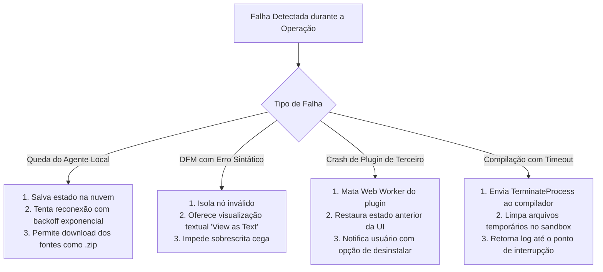

# 05 - Matriz de Riscos, Desafios Técnicos, "O Que Pode Dar Errado" (FMEA) e Soluções

> **Projeto:** PascalWeb IDE  
> **Área:** Engenharia de Riscos, Arquitetura de Resiliência e Soluções de Contenção  
> **Status:** Análise Crítica Aprovada - Baseline 1.0  

---

## 1. Vantagens Competitivas e Estratégicas da Solução

Antes de dissecar os pontos críticos, é fundamental consolidar os pilares que tornam o projeto da **PascalWeb IDE** altamente vantajoso e transformador para o mercado Delphi:

1. **Independência de Hardware e Sistema Operacional do Desenvolvedor:**
   * O programador pode codificar, desenhar telas e gerenciar projetos a partir de qualquer sistema operacional (Linux, macOS, ChromeOS ou Windows leve), delegando a compilação pesada para o agente Windows.
2. **Onboarding Instantâneo de Novos Desenvolvedores:**
   * Elimina semanas gastas na configuração manual de Library Paths e instalação de pacotes em novas máquinas; o projeto é clonado e executado imediatamente na nuvem.
3. **Preservação de Ativos Legados (Zero Lock-in):**
   * Total compatibilidade de ida e volta com arquivos `.dpr`, `.dfm`, `.pas` e `.dproj`. O código gerado pela PascalWeb IDE compila sem alterações no RAD Studio oficial e vice-versa.
4. **Produtividade Aumentada por Inteligência Artificial:**
   * Assistente de IA treinado especificamente nas idiossincrasias do Object Pascal moderno (evitando alucinações comuns de IAs generalistas que geram sintaxe inválida ou misturam convenções do C#/Java).
5. **Arquitetura Aberta para o Ecossistema:**
   * Criação de um ecossistema de plugins para componentes da comunidade (como ACBr, Horse, Boss, RESTDataware, Fortes Report).

---

## 2. O Que Pode Dar Errado: Matriz FMEA (Failure Mode and Effects Analysis)

A tabela abaixo aplica a metodologia FMEA para antecipar falhas operacionais, avaliando Severidade (S: 1-10), Ocorrência (O: 1-10), Detecção (D: 1-10) e o Número de Prioridade de Risco ($RPN = S \times O \times D$), apresentando a **Solução Técnica Definitiva** para cada cenário:

| # | O Que Pode Dar Errado? (Modo de Falha) | Efeito no Sistema | S | O | D | RPN | Solução Técnica Definitiva (Foco na Solução) |
| :-: | :--- | :--- | :-: | :-: | :-: | :-: | :--- |
| **F01** | **DFM corrompido ou propriedade proprietária apagada durante o save.** | Telas complexas perdem propriedades ao serem salvas pela Web IDE. | 9 | 7 | 4 | **252** | **Lossless AST Parsing & Unknown Property Preservation:** O parser de DFM trata nós desconhecidos como objetos literais opacos (*raw tokens*). Ao salvar, qualquer propriedade não reconhecida pelo Form Designer é reescrita exatamente como foi lida, preservando 100% da integridade do arquivo. |
| **F02** | **Conflito de sincronização bidirecional entre o código .PAS e o Form Designer.** | Código e tela ficam descompassados (ex: botão existe na tela mas não na classe). | 8 | 6 | 4 | **192** | **Single Source of Truth na AST:** A AST em memória é a única autoridade. O Form Designer não edita o DOM diretamente; ele despacha mutações tipadas para a AST. A serialização do `.pas` e do `.dfm` ocorre de forma atômica sob a mesma transação lógica. |
| **F03** | **Agente Local travado por compilação em loop infinito ou diálogo modal do Windows.** | A Web IDE fica bloqueada eternamente esperando o término do build. | 7 | 5 | 3 | **105** | **Process Watchdog & UI Suppression Flag:** O agente invoca o compilador com timeout rígido (configurável, padrão 120s) e passa a flag de compilação silenciosa (`-B -Q` ou `/p:PreBuildEventUseInBuild=false`), matando a árvore de processos (`TerminateProcessTree`) se o tempo limite expirar. |
| **F04** | **Código malicioso enviado para compilar no Agente de Servidor (RCE).** | Invasor executa comandos no servidor de compilação através de scripts de pré-build. | 10 | 3 | 3 | **90** | **Strip Pre/Post Build Events & Job Sandbox:** O agente de servidor remove qualquer tag `<PreBuildEvent>` e `<PostBuildEvent>` do arquivo `.dproj` antes de compilar e executa o processo em usuário restrito sem privilégios dentro de um Windows Job Object isolado. |
| **F05** | **Binários gerados (.exe/.bpl) gigantescos excedem limite de memória/upload.** | Timeout ou estouro de memória ao transferir o `.exe` compilado para a Web IDE. | 6 | 7 | 2 | **84** | **Streaming Chunked & Retenção Local Preferencial:** No Agente Local, o binário não é transferido via HTTP; ele é mantido no disco local e apenas o caminho físico é reportado. No Agente de Servidor, utiliza-se upload multipart com stream particionado (chunks de 5 MB) direto para S3/MinIO. |
| **F06** | **Incompatibilidade de encoding (ANSI/Windows-1252 vs UTF-8).** | Acentuações e caracteres em português são corrompidos (mojibake) ao salvar. | 6 | 8 | 2 | **96** | **Detector Universal de Codificação com Preservação de Encoding:** O editor lê o BOM e analisa a frequência de bytes. Se o arquivo original for Windows-1252, ele é mantido e salvo em Windows-1252, a menos que o usuário solicite explicitamente a conversão para UTF-8. |
| **F07** | **Plugin de terceiro causa crash ou trava a interface do usuário.** | Desenvolvedor perde o trabalho não salvo devido a um erro em um plugin. | 8 | 4 | 2 | **64** | **Isolamento de Plugins em Web Workers (Process Isolation):** Plugins não rodam na thread principal da interface. Rodam em Web Workers independentes com canais RPC isolados. Se o worker do plugin travar, o host encerra o worker sem afetar a sessão de edição. |

---

## 3. Desafios Técnicos Críticos e Como Solucioná-los

### Desafio 1: Emulação do Sistema de Layout VCL no Navegador (Align, Anchors e ParentFont)
* **O Desafio:** A VCL do Delphi possui regras rígidas e proprietárias de posicionamento de controles baseadas nas APIs nativas do Win32. No Delphi, `alTop` redimensiona e ancora o topo, enquanto `Anchors = [akLeft, akRight]` estica o controle quando o formulário é redimensionado. O modelo flexbox/grid nativo do CSS não se comporta nativamente como a VCL.
* **A Solução:**
  1. Criação de uma **VCL Layout Engine em TypeScript**: A superfície do formulário utiliza um motor customizado de cálculo geométrico em duas fases:
     * **Fase 1 (Align Resolution):** Varre todos os controles ordenados por `TabOrder` e processa controles alinhados (`alTop`, `alBottom`, `alLeft`, `alRight`, `alClient`), calculando seus retângulos delimitadores (`BoundsRect`).
     * **Fase 2 (Anchors Resolution):** Para controles com `alNone`, calcula as distâncias relativas às bordas do container pai e atualiza suas coordenadas `Left`, `Top`, `Width`, `Height` proporcionalmente.
  2. Isso garante que ao redimensionar a janela do formulário no Form Designer, os componentes se comportem com 100% de fidelidade ao executável compilado no Windows.

---

### Desafio 2: Suporte a Bibliotecas Legadas Gigantescas (ACBr, DevExpress, Jedi)
* **O Desafio:** Aplicações Delphi corporativas raramente usam apenas componentes nativos. Elas dependem de centenas de bibliotecas proprietárias instaladas na máquina do desenvolvedor. Tentar emular os milhares de componentes de terceiros na Web é inviável no primeiro momento.
* **A Solução:**
  1. **Arquitetura de Placeholders Visuais Inteligentes:** Componentes que não possuem um renderizador visual específico são desenhados como caixas funcionais exibindo o ícone da classe e o nome do identificador (ex.: `[cxGrid1: TcxGrid]`), permitindo redimensionamento, movimentação e edição completa de propriedades pelo Object Inspector.
  2. **Arquitetura de Plugins de Componentes:** A comunidade e os próprios desenvolvedores podem criar pacotes de extensão contendo arquivos SVG/HTML para renderizar componentes de suas bibliotecas favoritas no Form Designer.
  3. **No Agente de Compilação:** Como o Agente Local utiliza a instalação do RAD Studio existente na máquina do desenvolvedor, todos os DCUs e BPLs dessas bibliotecas continuam plenamente acessíveis para a compilação final.

---

### Desafio 3: Gerenciamento de Projetos com Pacotes BPL e Múltiplas DLLs
* **O Desafio:** Sistemas modulares Delphi utilizam pacotes dinâmicos (`.bpl`) e bibliotecas compartilhadas (`.dll`), onde um executável principal depende de múltiplos pacotes compilados na ordem correta.
* **A Solução:**
  1. **DAG de Dependências de Projeto:** O gerenciador de projetos implementa um grafo acíclico dirigido (DAG) que analisa as dependências entre os arquivos `.dpk` e `.dpr` no arquivo de grupo de projetos (`.groupproj`).
  2. **Orquestração de Compilação em Cascata:** Ao solicitar "Build Group", o agente compila primeiro os pacotes de base, garantindo que as saídas `.dcp` e `.bpl` estejam disponíveis no diretório de saída antes de compilar os módulos dependentes.

---

### Desafio 4: Performance e Responsividade ao Manipular Códigos Monolíticos
* **O Desafio:** Units legadas de Delphi frequentemente possuem mais de 20.000 a 50.000 linhas de código em um único arquivo `.pas`, o que pode travar editores web ingênuos.
* **A Solução:**
  1. **Virtualização Extrema de Linhas:** Uso do Monaco Editor com virtualização de nós no DOM (apenas as linhas visíveis na tela são renderizadas).
  2. **Tokenização Assíncrona e Web Workers:** O parser sintático e o assistente de autocompletion rodam em threads de background (Web Workers), sem compartilhar a thread de renderização da UI.

---

## 4. Plano de Contingência e Resiliência Operacional

