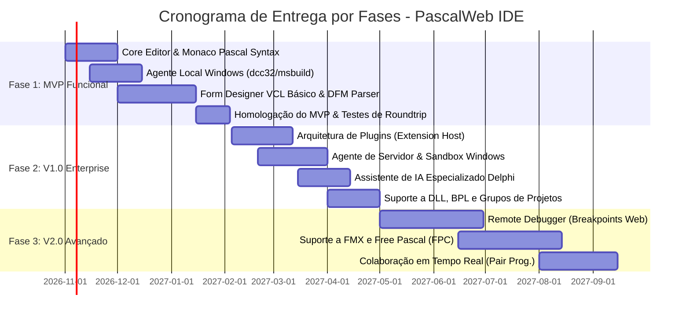

# 06 - Roadmap Evolutivo, Fases de Implementação e Matriz de Priorização

> **Projeto:** PascalWeb IDE  
> **Área:** Planejamento Estratégico de Produto & Engenharia de Software  
> **Status:** Roadmap Aprovado - Baseline 1.0  

---

## 1. Matriz de Priorização (Impacto vs. Complexidade)

Para maximizar o retorno de valor e mitigar riscos técnicos logo no início, os módulos do projeto foram classificados na matriz abaixo:

```text
       ALTO |  [RF02] Editor Pascal + Atalhos      |  [RF03] Form Designer WYSIWYG
            |  [RF04-A] Agente Local de Compilação |  [RF03-B] Sync Bidirecional DFM/PAS
   I        |--------------------------------------+------------------------------------
   M  MÉDIO |  [RF01] Gerenciador de Arquivos/DPR  |  [RF06] Sistema de Plugins
   P        |  [RF05] Assistente de Código IA      |  [RF04-B] Agente de Build Servidor
   A        |--------------------------------------+------------------------------------
   C  BAIXO |  Gerador de Relatórios de Build      |  Suporte a FireMonkey (FMX) 3D
   T        |  Temas Visuais (Dark/Light)          |  Depuração Remota Interativa (F7/F8)
   O        +---------------------------------------------------------------------------
                             BAIXA / MÉDIA                           ALTA
                                              COMPLEXIDADE
```

* **Vitórias Rápidas (Alto Impacto / Média Complexidade):** Editor Monaco com gramática Pascal, Agente Local de compilação via WebSocket, Gerenciador de arquivos `.dpr`/`.pas`.
* **Projetos Estratégicos Críticos (Alto Impacto / Alta Complexidade):** Form Designer visual WYSIWYG com sincronização bidirecional de DFM e injeção automática de código na seção `published` do `.pas`.
* **Evoluções Modulares (Médio Impacto / Média-Alta Complexidade):** Sistema de Plugins via Web Workers e Agente de Servidor para CI/CD corporativo.

---

## 2. Fases de Entrega e Marcos Evolutivos



---

### Fase 1: MVP Funcional (Foco em Usabilidade e Compilação Básica)
* **Objetivo:** Permitir que um desenvolvedor abra um projeto Delphi Win32 existente, visualize e altere a tela principal, edite o código com autocomplete e atalhos clássicos, dispare a compilação no Agente Local e obtenha o `.exe` funcional com relatório de erros estruturados.
* **Entregas:**
  1. Editor de Código (Monaco) com Syntax Highlighting Object Pascal e atalhos F12 (alternar tela/código) e Ctrl+Shift+C (class completion).
  2. Gerenciador de Projetos navegando na árvore de arquivos `.dpr`, `.pas` e `.dfm`.
  3. Form Designer WYSIWYG com catálogo VCL Standard (`TButton`, `TLabel`, `TEdit`, `TMemo`, `TPanel`, `TCheckBox`, `TComboBox`) e Object Inspector.
  4. Parser DFM bidirecional (texto e conversão básica de binário) com sincronização na seção `published` da unit.
  5. Agente Local Windows (CLI / System Tray) comunicando via WebSocket TLS, executando `dcc32.exe` / `msbuild.exe` e retornando erros e binários.

#### Critérios de Go / No-Go do MVP:
* [ ] Abertura de 50 formulários VCL reais sem quebra de propriedades desconhecidas no `.dfm`.
* [ ] Compilação de um projeto comercial via Agente Local com tempo de resposta $< 1 \text{ segundo}$ de overhead.
* [ ] Zero corrupção de arquivos de código fonte ao salvar.

---

### Fase 2: Versão 1.0 (Enterprise Ready, Plugins e Nuvem)
* **Objetivo:** Adicionar capacidade de extensão modular via plugins, suporte a projetos complexos com pacotes BPL/DLL, agente corporativo em servidor dedicado e IA assistiva.
* **Entregas:**
  1. Microkernel de Plugins: Web Worker sandbox, API de comandos, registro de componentes customizados na paleta visual.
  2. Agente de Servidor Windows com fila de compilação, controle de quotas e sandbox contra RCE via Windows Job Objects.
  3. Assistente de IA para geração de código Delphi, refatoração e detecção de memory leaks.
  4. Suporte a projetos multi-módulo (`.groupproj`, `.dpk`, `.bpl`, `.dll`) com resolução de dependências em cascata.
  5. Suporte a componentes Win32 (`TPageControl`, `TListView`, `TTreeView`, `TStatusBar`) e Data Controls com placeholders.

#### Critérios de Go / No-Go da V1.0:
* [ ] Pelo menos 2 plugins funcionais homologados (ex.: Plugin ACBr e Plugin de Linters).
* [ ] Isolamento comprovado de processos de compilação em servidor com bloqueio total de comandos arbitrários de shell.
* [ ] Suporte a compilação incremental reduzindo o tempo de builds subsequentes em pelo menos 60%.

---

### Fase 3: Versão 2.0 (Inovação e Expansão de Plataforma)
* **Objetivo:** Suporte a depuração interativa remota, multiplataforma com Free Pascal e colaboração simultânea na nuvem.
* **Entregas:**
  1. Depuração Interativa (Remote Debugging): breakpoints no editor, inspeção de variáveis (`Watch List`), Call Stack e execução passo a passo (F7/F8).
  2. Motor de renderização FireMonkey (FMX) para aplicações móveis e multiplataforma.
  3. Integração com Free Pascal (FPC / Lazarus) para compilação 100% livre sem dependência do RAD Studio.
  4. Colaboração em tempo real (estilo Google Docs / Live Share) com multi-cursor e bloqueio otimista de componentes no designer.
